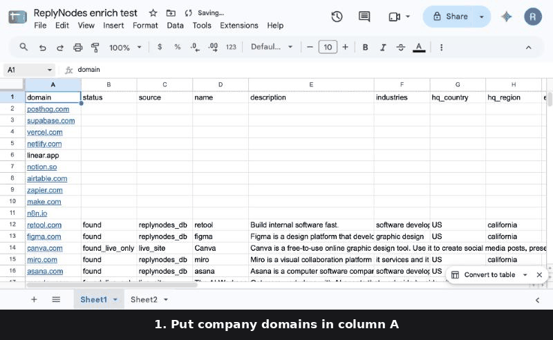

# Enrich companies by domain (n8n + Google Sheets)

Put domains in a Google Sheet, run the workflow, and get company name, description, industry, HQ country, employee range and funding back in the same rows. Data comes from the ReplyNodes company database. If a company is not in the database, the workflow falls back to the live website for name and description and says so in the `status` column.



## What you need

- n8n (tested on 2.35.7) and a Google account.
- A ReplyNodes API key. New accounts get 500 free credits: https://replynodes.com/auth.md

## Cost

A lookup that finds a company costs **1 credit**. Lookups that find nothing, and errors, are free. The live-site fallback uses the keyless Markdown endpoint (public daily limit, no credits). See https://replynodes.com for current pricing.

## Setup

1. **Create the sheet.** Paste this header row into row 1, then add one domain per row under `domain` (a full URL also works):

   ```
   domain	status	source	name	description	industries	hq_country	hq_region	employees_min	employees_max	funding_total_usd	latest_round_type	latest_round_date	data_loaded_at	checked_at	error
   ```

2. **Import** [`workflow.json`](workflow.json): Workflows, Import from File.
3. **Google Sheets:** open **Read domains** and **Write row**, connect your Google account, and pick the same spreadsheet and tab in both. Then, in **Write row**, set **Mapping Column Mode** to **Map Automatically** and **Column to match on** to `row_number`. (n8n clears these two settings whenever you pick a spreadsheet, so set them after choosing the sheet.)
4. **API key:** create a **Header Auth** credential named `ReplyNodes API` with header name `Authorization` and value `Bearer <your key>`. Select it in both **Search company** nodes.
5. Click **Execute workflow**.

Only rows with an **empty `status`** are processed. Add rows and run again whenever you like. To re-check a row, clear its `status` cell.

## What the workflow does per row

1. Normalizes the domain (`https://www.Stripe.com/pricing` becomes `stripe.com`).
2. Looks it up in the company database, one row at a time, about one per second (the API allows one search at a time).
3. Accepts a result only if its domain is exactly the one you asked for.
4. Not found: fetches the homepage metadata from the live site (name and description only).
5. Retries once on 429, 503 or 504 (waits for `Retry-After`, at least 30 seconds after a 504), then records the error and moves on. A bad row never stops the run.

## `status` values

| status | meaning |
|---|---|
| `found` | exact domain match in the company database |
| `found_live_only` | not in the database; name and description come from the website, `source` is `live_site`; no size or funding |
| `not_found` | not in the database and the live site could not be read; see `error` |
| `skipped_duplicate` | same domain appeared earlier in this run |
| `error` | invalid domain, HTTP error, bad API key (401), out of credits (402), or the retry failed; see `error` |

Failed lookups are never written as blank rows: they carry a status and an error message.

## Know the limits of the data

The database is built from third-party datasets (`data_loaded_at` shows when it was last loaded). Check a sample before relying on it.

- Coverage is not complete. In a test of 20 well-known domains on 2026-11-19, 16 returned the right company; `calendly.com`, `typeform.com` and `firecrawl.dev` were missing (the live-site fallback fills those in).
- A few domains map to the wrong company. For example `gumroad.com` returns a record named AirPitch.
- Some records are old, and some fields are empty. Funding is present on roughly 6 in 10 records and a description on about 8 in 10. Industry labels can look odd (`stripe.com` is labelled "facilities services").
- It does one exact-domain lookup per row. It does not search by company name or by description.

Need fresher data for one site? The [Markdown API](https://md.replynodes.com) fetches the live page.

## Output example

Real rows from a test run (2026-11-19):

| domain | status | name | industries | hq | employees | funding |
|---|---|---|---|---|---|---|
| posthog.com | found | posthog | software development | US, california | 11-50 | 27,150,000 USD, series_b (2021-06-10) |
| supabase.com | found | supabase | it services and it consulting | US | 51-200 | empty |
| calendly.com | found_live_only | Calendly.com | empty | empty | empty | empty |

## Tested

Run end to end on n8n 2.35.7 with 10 rows covering: found, partial data, live-site fallback, URL normalization, invalid domain, duplicate, a 429 that succeeds on retry, a 504 that fails after the retry, and a company that is not found anywhere. The API responses used in that run were captured from the live service. The Google Sheets nodes use n8n's built-in node and were not run against a real spreadsheet in that test, so tell us if the sheet step misbehaves: [open an issue](../../issues).

## Attribution

Requests carry an `X-Source: n8n-company-research/enrich-by-domain` header so ReplyNodes can count template usage. Only the domains you submit are sent. Change or remove it in the **Settings** node and the HTTP Request nodes.
